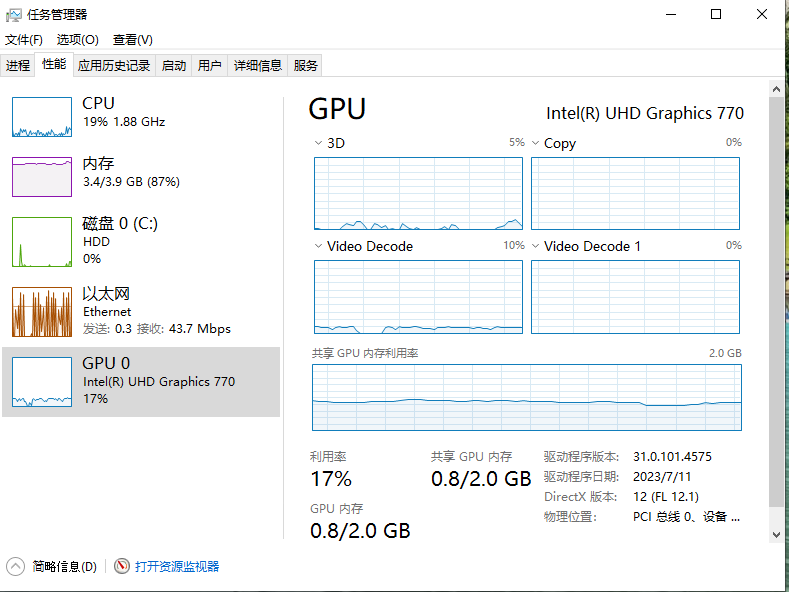
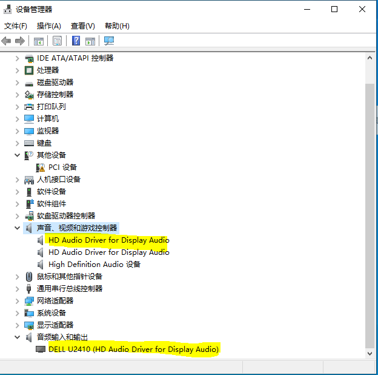
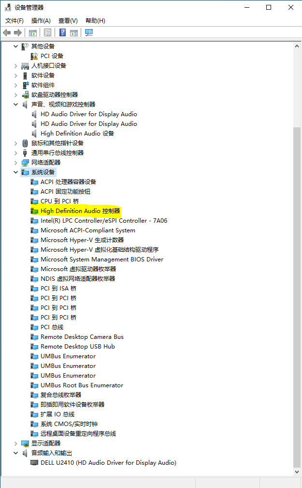

## Intel Core Graphics Passthrough ROM

### Introduction
- This ROM is an Intel 10-13 Core Graphics Passthrough PCI optionROM. It can be used with OVMF to start the virtual machine, and the display HDMI/DP output screen and HDMI/DP sound work normally.
- This ROM is easy to use, and there is no need to modify or customize OVMF. Just use PVE!
- The virtual machine starts without a distorted screen or a blue screen.

> [!IMPORTANT]
> **Verified MS-01 paths:** physical HDMI output and accelerated Intel rendering
> were verified on an S1260-class MS-01 with iGPU `8086:46a6`, Proxmox VE
> 9.2.11, official `pve-qemu-kvm` 11.0.3-3, and Ubuntu 26.04.1. Physical HDMI
> output was also verified on a tested S1290 unit with iGPU `8086:4626` and Ubuntu
> 22.04.5/kernel `5.15.0-97-generic`, but only after disabling Wayland and Xorg
> hardware acceleration. The S1290 result is software-rendered and its exact
> ROM is tracked in `roms/` and included in the node manifest. Physical HDMI output
> and accelerated Intel rendering were verified on an S1390-class MS-01 with iGPU `8086:a720`, the tracked
> `6e166a89e84b...` ROM, and Ubuntu 22.04 HWE kernel `6.8.0-138-generic`; the
> guest bound the IGD to `i915`, created DRM, and ran accelerated Xorg with
> Mesa Iris and direct rendering. The older
> `5.15.0-97-generic` kernel did not bind this PCI ID. These results are
> specific to the hardware and software below; the other ROMs and recipes in
> this repository remain upstream or experimental alternatives.

For a clean installation, follow the
**[complete MS-01 S1260 installation and rollback guide](docs/ms01-s1260-installation.md)**.
It starts with an unmodified PVE host and guest, uses the ROM tracked here, and
ends with physical-display and hardware-acceleration acceptance checks.

### Build and deployment are separate

`tools/rebuild-rom.sh` is an offline build and verification tool for a build
machine. Its vendor archives and compiler sources are not installation
dependencies and do not need to be copied to PVE nodes.

Ansible deployment can consume the existing checksum-pinned ROM artifacts,
`roms/node-rom-manifest.json`, the node validator, and the pre-start hook.
`tools/manage-node-rom.py install` installs an existing ROM; it does not invoke
the rebuild tool or compile source. The manual installation guide documents
the node-side validation and configuration steps independently of the build.

### Portable node-local ROM alias

Cluster-portable mapped VMs use:

```text
hostpci0: mapping=MS01-IGD,romfile=ms01-igd-current.rom,x-vga=1
```

On each node, `ms01-igd-current.rom` is a relative symlink to the
content-addressed model ROM selected by
[`roms/node-rom-manifest.json`](roms/node-rom-manifest.json). The node-side tool
selects exactly one profile from the live IGD PCI device ID. Install the
qualified ROM and alias on the PVE node with the repository entrypoint:

```bash
sudo ./tools/manage-node-rom.py install
```

Candidate ROM staging requires `--allow-candidate` and does not qualify mapping
admission or pre-start acceptance.

The node-side validator checks the live PCI device ID, isolated IOMMU group,
alias containment, regular-file target, byte size, SHA-256, and every PCIR
image. The pre-start hook repeats those gates and validates OVMF, disabled
guest Secure Boot, machine type, portable `hostpci0`, and shared QEMU args.

To convert an existing stopped VM, use the guarded `configure-vm` action. It
requires the current VM name, primary MAC, and exact `VMID@NODE` token and
refuses a running VM or a guest whose EFI disk does not prove
`pre-enrolled-keys=0`. On success it applies the portable `hostpci0`, qualified
machine/args, `vga: none`, and `local:snippets/ms01-igd-pre-start-hook`.
These explicit gates are shown by `configure-vm --help`; they are not needed
for ordinary node ROM installation.

### Verified MS-01 S1260 / `8086:46a6` configuration

Copy [`roms/ms01-adlp-8086-46a6-gop21.0.1066.rom`](roms/ms01-adlp-8086-46a6-gop21.0.1066.rom)
to `/usr/share/kvm/` on the Proxmox host. Verify its SHA-256 against
[`roms/ROM-PROVENANCE.md`](roms/ROM-PROVENANCE.md). Use
[`tools/rebuild-rom.sh`](tools/rebuild-rom.sh) for the verified offline rebuild
or to supply model-specific GOP, helper-image, and PCI-ID parameters. Its
provenance runbook separates a first discovery build with optional checksums
from strict reproduction after the observed hashes have been reviewed.

Two attachment methods were verified. Choose exactly one; do not combine the
`hostpci0` or `args` lines from the two profiles.

#### Method A: direct PCI address

This is the shortest single-node configuration and embeds the host BDF directly
in the VM configuration:

```text
bios: ovmf
machine: pc-i440fx-11.0
vga: none
hostpci0: 0000:00:02.0,legacy-igd=1,romfile=ms01-adlp-8086-46a6-gop21.0.1066.rom
args: -set device.hostpci0.x-igd-opregion=on -set device.hostpci0.x-igd-gms=0x2
```

PVE's `legacy-igd=1` supplies the direct method's required guest topology, but
this is not QEMU legacy VGA initialization. Do not add
`x-igd-legacy-mode=on`: QEMU 11 rejects that property for this Gen12 device.

#### Method B: PVE PCI resource mapping

This keeps the VM configuration independent of a node's physical BDF. Create a
node-specific mapping first:

```bash
PVE_NODE=$(hostname -s)
IGD_GROUP_PATH=$(readlink -f /sys/bus/pci/devices/0000:00:02.0/iommu_group)
IGD_GROUP=${IGD_GROUP_PATH##*/}
test -n "$PVE_NODE"
test -n "$IGD_GROUP_PATH"
test "$(cat /sys/bus/pci/devices/0000:00:02.0/vendor)" = 0x8086
test "$(cat /sys/bus/pci/devices/0000:00:02.0/device)" = 0x46a6
test "$(find "${IGD_GROUP_PATH}/devices" -maxdepth 1 -type l -printf '%f\n')" = \
  0000:00:02.0
pvesh create /cluster/mapping/pci \
  --id MS01-IGD \
  --map \
    "node=${PVE_NODE},path=0000:00:02.0,id=8086:46a6,iommugroup=${IGD_GROUP}" \
  --description \
    'Exclusive onboard Intel Alder Lake-P IGD 8086:46a6; not live migratable' \
  --live-migration-capable 0
pvesh get /cluster/mapping/pci/MS01-IGD --output-format json-pretty
```

Derive and verify the group independently on every node. Then use the mapped
profile:

```text
bios: ovmf
machine: pc-i440fx-11.0
vga: none
hostpci0: mapping=MS01-IGD,romfile=ms01-igd-current.rom,x-vga=1
args: -set device.hostpci0.addr=02.0 -set device.hostpci0.x-igd-legacy-mode=off -set device.hostpci0.x-igd-opregion=on -set device.hostpci0.x-igd-gms=0x2
```

This path requires:

- Secure Boot disabled in the VM's EFI variable store; all three EFI payloads
  in the ROM are unsigned;
- an explicit host-ownership mode: use native-first late handoff when the host
  console must be available between VM runs, or early `vfio-pci` isolation for
  a dedicated passthrough host;
- only `00:02.0` assigned to the VM. Do not assign `00:1f.3` on the tested
  MS-01 because its IOMMU group contains host-critical chipset functions;
- a physical display connected to an MS-01 output.

Native-first late handoff is the recommended mode when host-console return is
required. The host boots with `i915`; VM startup hands the exclusive mapped IGD
to `vfio-pci`, and an explicit native-driver rebind restores `i915` after the
VM has stopped and no VM owns the IGD. Proxmox does not automatically restore
the host console after release.
This ownership sequence is validated on the sampled S1260 system, including
repeated handoff between mapped guests and return to the host.

Early isolation remains the dedicated-passthrough option. In that mode the IGD
is bound to `vfio-pci` from initramfs and `i915` is blacklisted, so the host
does not provide a local graphics console or use the IGD while running.

The mapped PVE 9.2/QEMU 11 path fixes the guest IGD address to `02.0` and
explicitly sets `x-igd-legacy-mode=off`. Do not add `legacy-igd=1`,
`x-igd-legacy-mode=on`, or `x-igd-lpc=on` to the mapped profile. The last option
conflicts with the PVE i440fx bridge at guest `00:1f.0`.

The mapping is cluster configuration, but each `map` entry is node-specific.
To make the logical `MS01-IGD` name usable on another PVE node, add a separately
verified entry for that node under the same mapping ID and install the identical
checksum-verified ROM in `/usr/share/kvm/` on that node. Keep
`live-migration-capable` disabled: this physical IGD is exclusive and the
verified setup does not support live migration.

Both methods remain exclusive GPU passthrough and do not support live
migration. No patched QEMU, custom OVMF, second audio ROM, or PCH-audio
passthrough was used for either verified profile.

The verified Ubuntu guest ran GDM on Wayland, reported HDMI-A-1 connected, and
used Mesa Intel Iris Xe Graphics (ADL GT2) through `/dev/dri/card0` and
`renderD128`. Device-specific recovery material and experiment logs are kept
outside this public repository.

### Verified S1290 / `8086:4626` software-output configuration

A tested S1290 unit was verified with the mapped-device profile
above adjusted to its exact `8086:4626` identity, exact
`subsystem-id=0000:0000`, and exact model-specific ROM. The mapped profile used
`x-igd-legacy-mode=off`, OpRegion enabled, and GMS `0x2`; live migration
remained disabled. Do not substitute the tracked S1260 `8086:46a6` ROM.

With Ubuntu 22.04.5/kernel `5.15.0-97-generic`, the accelerated Wayland path
could detect HDMI and EDID but failed to create a scanout framebuffer. The
verified fallback forced GDM to Xorg and selected the `modesetting` driver with
`Option "AccelMethod" "none"`. It produced an active 1600x1200 HDMI mode on
pipe A, `ShadowFB`, and `swrast`; the operator confirmed the physical monitor
showed GDM or the desktop. This proves physical output, not hardware
acceleration. See the installation guide's Ubuntu 22.04 fallback and
[`MS01-IGD-COMPATIBILITY.md`](MS01-IGD-COMPATIBILITY.md) for the exact boundary.

### Other upstream recipes (not verified on this MS-01)

This English fork was originally translated before the latest changes in
[BGzEroll/igd](https://github.com/BGzEroll/igd). The upstream README changes
through commit
[`86cfdff`](https://github.com/BGzEroll/igd/commit/86cfdfff484ba7c92f01b7f8e4d57bcc47c507ac)
(2025-05-23) add or clarify the following:

- the file name is `vfio.conf`, not `vifo.conf`;
- the suggested QEMU arguments now include the fixed IGD address and OpRegion:

  ```
  args: -set device.hostpci0.addr=02.0 -set device.hostpci0.x-igd-gms=0x2 -set device.hostpci0.x-igd-opregion=on
  ```

- the upstream candidate stanza uses `11-14.rom` for the iGPU and passes the
  PCH audio function separately:

  ```
  hostpci0: 0000:00:02.0,legacy-igd=1,romfile=11-14.rom
  hostpci1: 0000:00:1f.3
  ```

- the final upstream note appears to say that QEMU 9.2 and newer should instead
  use Q35 and omit `legacy-igd=1`:

  ```
  machine: q35
  hostpci0: 0000:00:02.0,romfile=11-14.rom
  ```

The QEMU 9.2 wording is ambiguous in the original Chinese README and is
recorded here as an upstream claim, not as an MS-01-verified configuration.
It also conflicts with the older i440fx/legacy-IGD instructions later in this
document, so choose one path; do not combine the two machine configurations.

> [!WARNING]
> Upstream does **not** currently publish `11-14.rom` in the repository.
> Consequently, that upstream stanza is not self-contained and cannot be
> followed from this checkout. Do not rename or silently substitute one of the
> existing ROMs. It is not required by the verified `8086:46a6` path above.

#### MS-01 preflight and safety notes

Before changing boot parameters, driver binding, or a VM configuration, collect
the live device and IOMMU layout:

```bash
lspci -nnk -s 00:02.0
lspci -nnk -s 00:1f.3
find /sys/kernel/iommu_groups/ -type l | sort
cat /proc/cmdline
pveversion -v
qm config <VMID>
```

- Do not copy the example `8086:a780` ID blindly. Bind the IDs reported by the
  target MS-01.
- Do not pass `00:1f.3` automatically. Confirm that it is the intended audio
  function, inspect every device in its IOMMU group, and make sure the Proxmox
  host does not need it.
- Full passthrough makes the iGPU exclusive to one running VM. The host loses
  local display, `/dev/dri`, and Quick Sync access while the VM owns it. Verify
  remote management and preserve a rollback path before changing ownership.
- When host-console return is required, prefer native-first late handoff and
  explicitly restore the native driver after the VM stops. Use early
  `vfio-pci` isolation when the host is dedicated to passthrough.
- Upstream now suggests blacklisting both `i915` and `snd_hda_intel`. Blacklist
  the audio driver only when the audio function is intentionally assigned to
  the guest.
- Upstream also recommends
  `options vfio_iommu_type1 allow_unsafe_interrupts=1`. Do not enable this by
  default: it weakens interrupt-isolation guarantees. Consider it only after a
  specific interrupt-remapping failure has been observed and the risk is
  accepted.
- Confirm after reboot that the intended functions use `vfio-pci` before
  starting the VM:

  ```bash
  lspci -nnk -s 00:02.0
  lspci -nnk -s 00:1f.3
  ```

### How to use:

+ This ROM needs to use two rom files:
  - Core display pass-through OptionROM: gen12_igd.rom -- basically universal for all platforms
  - GOP ROM: --- Select the corresponding rom file according to different core display platforms, see the table below:

GOP ROM file name     | Applicable CPU platform
----------------------|----------------------------
gen12_gop.rom         | Intel 11-13th generation
5105_gop.rom          | N5105 / N5095
8505_gop.rom          | 8505

  - Please select the corresponding GOP ROM according to the CPU of the host. Selecting the wrong GOP ROM function will result in no startup screen

+ Copy these two ROM files to `/usr/share/kvm/`
+ Because two rom files are used, in the conf configuration file, one rom file is added to the graphics card and the other is added to the sound card, please pay attention.
```
hostpci0: 0000:00:02.0,legacy-igd=1,romfile=gen12_igd.rom
hostpci1: 0000:00:1f.3,romfile=gen12_gop.rom
```
### You can refer to my 100.conf, pay attention to the following matters:

+ The model must be i440fx, (QEMU does not support Q35 display in Legacy mode, QEMU can be customized to support Q35, which is not discussed in this article)
+ BIOS must be OVMF, Intel core graphics no longer supports traditional BIOS boot
+ Add legacy-igd=1 to the core graphics PCI to support display in Legacy mode
+ Add args: -set device.hostpci0.addr=02.0 -set device.hostpci0.x-igd-gms=0x2 -set device.hostpci0.x-igd-opregion=on
+ "-debugcon in args file:/root/d-debug.log -global isa-debugcon.iobase=0x402” is a debugging file, don’t add it if you mind
+ The virtual machine memory is at least 4G, less than 4G may have problems
+ It is recommended to x-igd-gms=0x2, and pay attention to the BIOS setting: DVMT pre allocated, not more than 64M

### Usage restrictions

+ This ROM does not support commercial use, only for DIY enthusiasts technical research
+ This ROM only supports Intel core graphics, not AMD
+ Only supports UEFI, normal boot. Secure boot is not supported
+ Only supports OVMF mode, seabios does not support
+ The memory is at least 4G, less than 4G may have problems
+ Note the BIOS setting: DVMT pre allocated, not more than 64M, 64M corresponds to x-igd-gms=0x2, if it exceeds 64M, x-igd-gms needs to be increased!

### This ROM is only tested in the following environments, and I have not tested other environments.

+ South China Gold 760 motherboard + 13600CPU
+ PVE 8.0.3
+ The test results are basically perfect, with logo and startup screen, no screen distortion, and HDMI/DP sound working properly. You can also complete the entire Windows reinstallation.

#### YouTube plays 4K video: Task Manager GPU occupancy
> 

#### HDMI Audio 
> 

### Common errors

1. No startup logo display and boot animation
  + PVE shell Use the command to start the virtual machine. You must only see the following sound card errors. If there are other errors, check the PVE passthrough settings. Refer to the following personal settings
```
    root@pve:/etc/pve/qemu-server# qm start 300
    kvm: vfio: Cannot reset device 0000:00:1f.3, no available reset mechanism.
    kvm: vfio: Cannot reset device 0000:00:1f.3, no available reset mechanism.
```
  + `/etc/modprobe.d/vfio.conf` must not set `disable_vga=1`. If it does,
    remove that option, run `update-initramfs -u`, and restart PVE.

2. No HDMI/DP sound
  + First check the audio controller driver: Device Manager->System Devices->HD audio controller. If not, check the chipset and audio driver
  + 
  + You can delete the graphics driver and install it after restarting
  + Install Windows completely from scratch in the core graphics pass-through mode (this ROM supports it, and there is no screen distortion during the installation process)

### Welcome to provide debugging information

+ I only have one machine and cannot test more platforms. Welcome to provide test debugging information.
+ Confirm to open args in the conf file: -debugcon file:/root/igd_debug.log -global isa-debugcon.iobase=0x402
+ Provide the generated debug file: /root/igd_debug.log
+ In the PVE host shell, send two commands: lspci -s 00:02.0 -xxx and lspci -s 00:00.0 -xxx, and send the output results to me

#### If you don’t want to use two rom files, you can also combine them into one.

### PVE graphics card pass-through settings:

- Edit grub, add intel_iommu=on
```
nano /etc/default/grub
```
- GRUB_CMDLINE_LINUX_DEFAULT="quiet intel_iommu=on"
```
update-grub
```
- Edit /etc/modules
```
nano /etc/modules
```
- Add the following modules
```
vfio
vfio_iommu_type1
vfio_pci
vfio_virqfd
```
- Add the graphics card driver to the blacklist
```
echo "blacklist i915" >> /etc/modprobe.d/pve-blacklist.conf
```
- Bind vfio-pci through the device ID and execute lspci -n | grep -E "0300" to view and record the integrated graphics VendorID and DeviceID
```
echo "options vfio-pci ids=8086:a780" >> /etc/modprobe.d/vfio.conf
```
```
update-initramfs -u
reboot
```
#### `vfio.conf` must not set `disable_vga=1`; remove it if present.

### PVE Windows 10 VM example conf:
```
args: -set device.hostpci0.addr=02.0 -set device.hostpci0.x-igd-gms=0x2 -set device.hostpci0.x-igd-opregion=on -debugcon file:/root/igd_debug.log -global isa-debugcon.iobase=0x402
bios: ovmf
boot: order=scsi0;ide0
cores: 4
cpu: host
efidisk0: local-lvm:vm-200-disk-0,efitype=4m,size=4M
hostpci0: 0000:00:02.0,legacy-igd=1,romfile=gen12_igd.rom
hostpci1: 0000:00:1f.3,romfile=gen12_gop.rom
ide0: local:iso/virtio-win-0.1.229.iso,media=cdrom,size=522284K
ide2: local:iso/Win10_22H2_English_x64.iso,media=cdrom,size=5971862K
machine: pc-i440fx-8.0
memory: 8192
meta: creation-qemu=8.0.2,ctime=1692935 943
name: Win10
net0: virtio=32:02:47:A8:40:01,bridge=vmbr0,firewall=1
numa: 0
ostype: win10
scsi0: local-lvm:vm-200-disk-1,iothread=1,size=60G
scsihw: virtio-scsi-single
serial1: socket
smbios1: uuid=d9fadf8d-eae0-4cb3-a3d5-cf222c305b91
sockets: 1
usb0: host=046d:c016,usb3=1
usb1: host=1c4f:0059,usb3=1
vga: none
vmgenid: 8f84e0f9-534d-440b-bb6 d-09ed75cdc167
```
Email: markc@renta.net


Email: gangqizai@gmail.com
